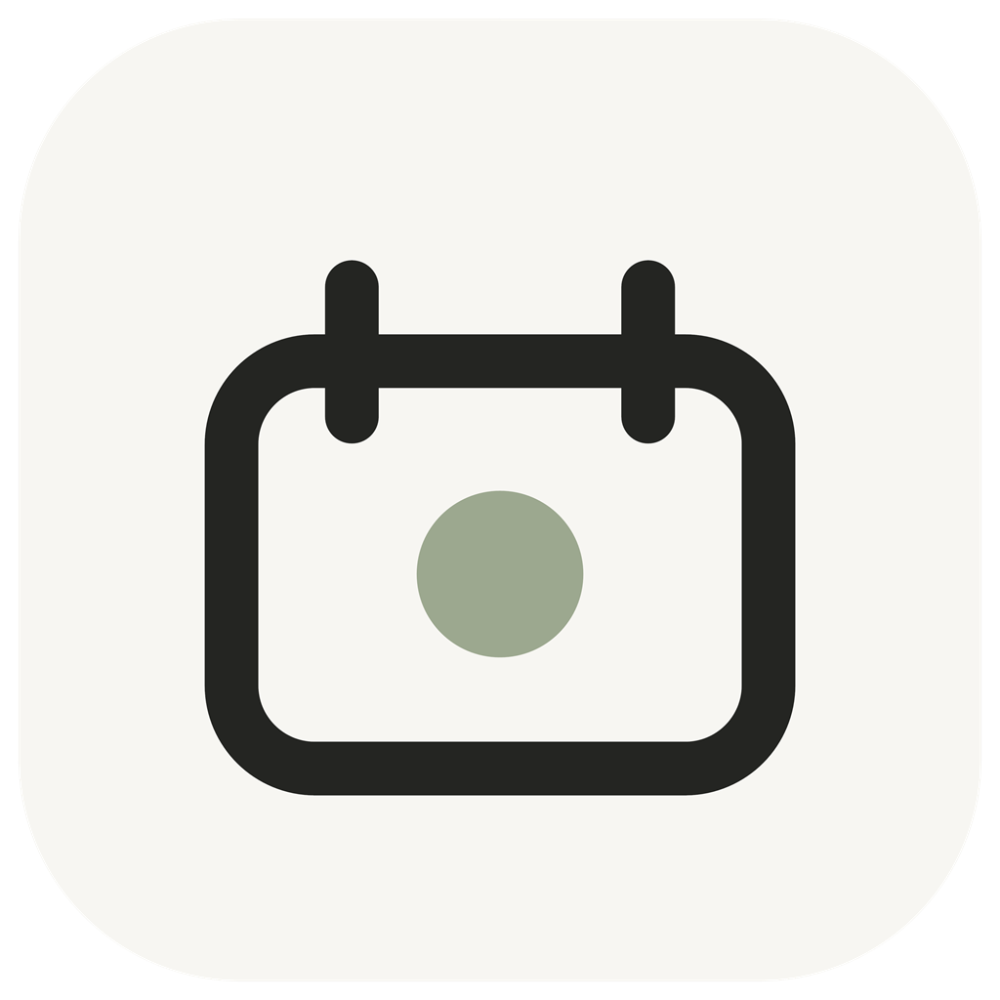

<p align="center">
  
</p>

<h1 align="center">Daily</h1>

<p align="center">一款安静、简洁、本地优先的 Android 日常事项提醒与记录应用。</p>

Daily 适合记录容易忘记但需要持续完成的小事，例如服药、补充维生素、滴眼液和运动。它以日历为入口，把每天的计划、完成情况与遗漏记录放在同一个界面中。

## 功能

- 日历查看：按日期查看当天所有事项与完成状态。
- 多次事项：同一事项可以设置多个提醒时间，并以子任务形式展开。
- 一键完成：完成项会在组内变灰并下沉，未完成项保持原位。
- 本地提醒：通知提供“完成”和可选的“稍后提醒”操作。
- 周期设置：支持每天或按星期重复，并可设置开始、结束日期。
- 周期预警：可在周期结束前一个月或一周提醒。
- 本地优先：事项和完成记录仅保存在设备的 SQLite 数据库中。
- 提醒诊断：应用内可以检查通知渠道、后台运行状态和已调度提醒。

## 技术栈

- Flutter / Dart
- SQLite（`sqflite`）
- Android 本地通知（`flutter_local_notifications`）
- `timezone` 与 `flutter_timezone`

## 开始开发

### 环境要求

- Flutter stable
- Dart 3.12 或更高版本
- Android SDK

### 运行

```bash
flutter pub get
flutter run
```

### 检查与测试

```bash
flutter analyze
flutter test
```

### 构建 Android APK

```bash
flutter build apk --release
```

构建产物位于 `build/app/outputs/flutter-apk/`。

## 项目结构

```text
lib/
├── app.dart                           # 页面、主题与交互组件
├── main.dart                          # 应用启动与依赖初始化
├── models.dart                        # 领域模型与存储接口
├── data/daily_database.dart           # SQLite 持久化
└── services/notification_service.dart # 通知调度与动作处理

test/                                  # 模型、界面、通知与资源测试
assets/branding/                       # 品牌和启动页素材
tool/                                  # 图标生成工具
```

## 数据与隐私

Daily 不需要账号，也不会把事项或完成记录上传到服务器。卸载应用或清除应用数据会删除本地记录，请在操作前自行确认。

Android 端使用通知权限来发送事项提醒，并监听设备启动事件以支持系统重启后的提醒恢复。部分系统可能需要手动允许后台运行。

## 参与贡献

欢迎提交 Issue 和 Pull Request。开始修改前请阅读 [CONTRIBUTING.md](CONTRIBUTING.md)。

## 项目状态

目前以 Android 为主要支持平台，核心记录、SQLite 持久化、本地通知、通知动作与周期提醒功能均已实现。

## 许可证

本项目采用 [MIT License](LICENSE) 开源。
